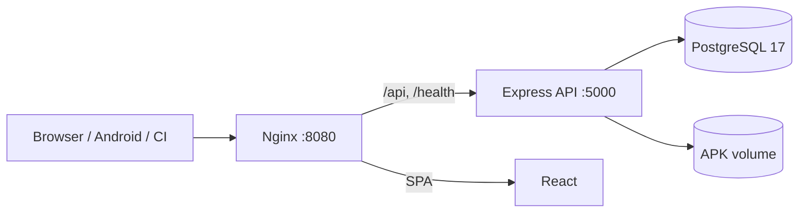

# Relixor

**Self-hosted private Android APK repository and release-management platform.**

Relixor gives Android teams one place to store builds, enforce approval before production, expose a controlled public download portal, record QA evidence, and integrate CI/CD — without handing artifacts to a third-party service.

[Documentation portal](/docs) · [API reference](/docs/api/reference) · [Installation](/docs/installation/quick-install) · [Security](/docs/security/index) · [Troubleshooting](/docs/troubleshooting/index)

---

## Features

- **Projects & apps** — organise packages with project/app-level access control.
- **Five channels** — DEV, QA, STAGING, BETA, PRODUCTION.
- **Release lifecycle** — upload → submit → approve → publish, plus promote, deprecate, rollback and archiving.
- **Approval gate** — production publication requires approval; developers cannot self-approve by default.
- **Integrity** — APK/ZIP validation, server-side SHA-256, optional CI checksum enforcement.
- **Secure downloads** — header-authenticated internal downloads; short-lived, single-use tickets for public/QR access.
- **Public portal** — `/portal` lists only approved, published PRODUCTION releases of explicitly public apps.
- **Android update API** — update check/latest with mandatory and minimum-supported-version flags.
- **QA & reports** — PASS/FAIL/BLOCKED records, JSON/CSV/PDF exports, audited.
- **Retention** — per-channel policies, dry-run, protected production/pinned releases, deletion off by default.
- **Account security** — revocable sessions, login history, hashed single-use reset tokens, admin session controls.
- **CI/CD** — scoped API tokens, GitLab pipeline example, checksum verification.
- **Operations** — Docker Compose, migrations on start, `/health`, audit log, role dashboards.

## Technology

| Layer | Stack |
|---|---|
| Frontend | React 18, TypeScript, Vite 5, Tailwind CSS |
| Backend | Node.js 20, Express 4, TypeScript, Zod, Prisma 5 |
| Database | PostgreSQL 17 |
| Storage | Local filesystem behind a `StorageProvider` interface |
| Runtime | Docker Compose, nginx reverse proxy |
| Tests | Jest + Supertest (integration, disposable PostgreSQL) |

## Architecture



Only nginx publishes a host port. The backend applies Prisma migrations at startup and exposes `/health` with database and storage checks. See [Architecture](/docs/architecture/overview).

## Quick start (Docker Compose)

Prerequisites: Linux host with Docker Engine 24+ and Compose v2, 2 GB RAM minimum.

```bash
git clone <your-repository-url> relixor
cd relixor
cp .env.example .env
chmod 600 .env
```

Set at minimum in `.env`:

```dotenv
POSTGRES_PASSWORD=<strong-random-password>
JWT_SECRET=<at-least-32-random-characters>
CORS_ORIGIN=http://localhost:8080
ADMIN_DEFAULT_EMAIL=admin@example.com
ADMIN_DEFAULT_PASSWORD=<strong-admin-password>
```

Generate values with `openssl rand -base64 32`. Then:

```bash
docker compose up -d --build
docker compose exec backend node dist/prisma/seed.js
curl -fsS http://localhost:8080/health
```

Open `http://localhost:8080` and sign in. Full walkthrough with expected output and failure handling: [Installation on Ubuntu](/docs/installation/quick-install).

## Configuration

All variables are documented in [Environment Variables](/docs/configuration/environment-variables). Key ones:

| Variable | Purpose |
|---|---|
| `POSTGRES_*`, `DATABASE_URL` | Database |
| `JWT_SECRET`, `JWT_EXPIRES_IN` | Session signing |
| `CORS_ORIGIN` | Exact browser origin(s); wildcard rejected in production |
| `ADMIN_DEFAULT_*` | First administrator seed |
| `STORAGE_LOCAL_DIR`, `MAX_FILE_SIZE_MB` | APK storage and upload limit |
| `RETENTION_ALLOW_DELETE` | Enables irreversible cleanup (default `false`) |
| `RETENTION_SCHEDULE_ENABLED` | Opt-in scheduler (default `false`) |

Never commit `.env` or real credentials.

## Documentation

The complete A–Z manual is served in-app at **`/docs`** and stored as Markdown in [`docs/`](docs/):

- [Getting started](/docs/getting-started/introduction)
- [Installation](/docs/installation/quick-install)
- [Production deployment](/docs/deployment/production)
- [Environment variables](/docs/configuration/environment-variables)
- [Architecture](/docs/architecture/overview)
- [Projects & apps](/docs/user-guide/project-management)
- [Users & RBAC](/docs/user-guide/user-management)
- [Releases](/docs/user-guide/release-management)
- [APK management](/docs/user-guide/apk-management)
- [Public portal](/docs/user-guide/public-portal)
- [QA & reports](/docs/user-guide/qa-reports)
- [Account security](/docs/user-guide/account-management)
- [Administrator manual](/docs/user-guide/admin-manual)
- [GitLab CI](/docs/integrations/gitlab-ci)
- [Android update API](/docs/integrations/android-update-api)
- [API reference](/docs/api/reference)
- [Database & migrations](/docs/administration/database)
- [Retention](/docs/administration/retention)
- [Backup & restore](/docs/administration/backup-restore)
- [Upgrade & rollback](/docs/administration/upgrade-rollback)
- [Security](/docs/security/index)
- [Troubleshooting](/docs/troubleshooting/index)
- [Development](/docs/development/index)
- [Testing](/docs/testing/index)
- [Known limitations](/docs/KNOWN-LIMITATIONS)
- [Project status](/docs/PROJECT-STATUS)

## Verification status

- Backend test suite: **13 suites / 155 tests pass** on a disposable PostgreSQL 17 database.
- Backend and frontend production builds: **pass**.
- Fresh migration replay: **7/7 applied**; `/health` returns **200**.
- Browser E2E and clean-VM Compose deployment: **not tested**.
- No commit, push, deployment or production migration was performed.

See [Project Status](/docs/PROJECT-STATUS) for evidence and [Known Limitations](/docs/KNOWN-LIMITATIONS) for gaps.

## Security

Please read [SECURITY.md](SECURITY.md) before reporting a vulnerability. Do not open a public issue containing exploit details or secrets. Operational hardening is covered in the [Security Guide](/docs/security/index).

## Contributing

See [CONTRIBUTING.md](CONTRIBUTING.md). Never commit secrets, APKs, database dumps or generated `dist`/`node_modules` content. Do not push or deploy without authorization.

## License

No license has been selected for this repository. Do not redistribute without the owner's permission.
