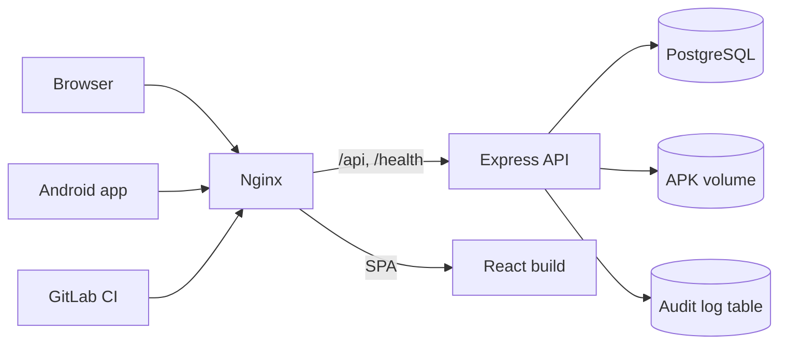
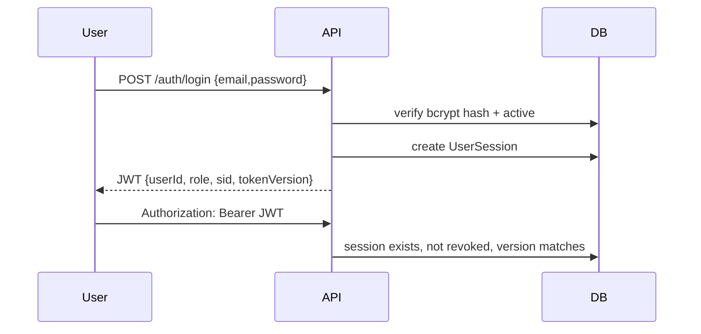
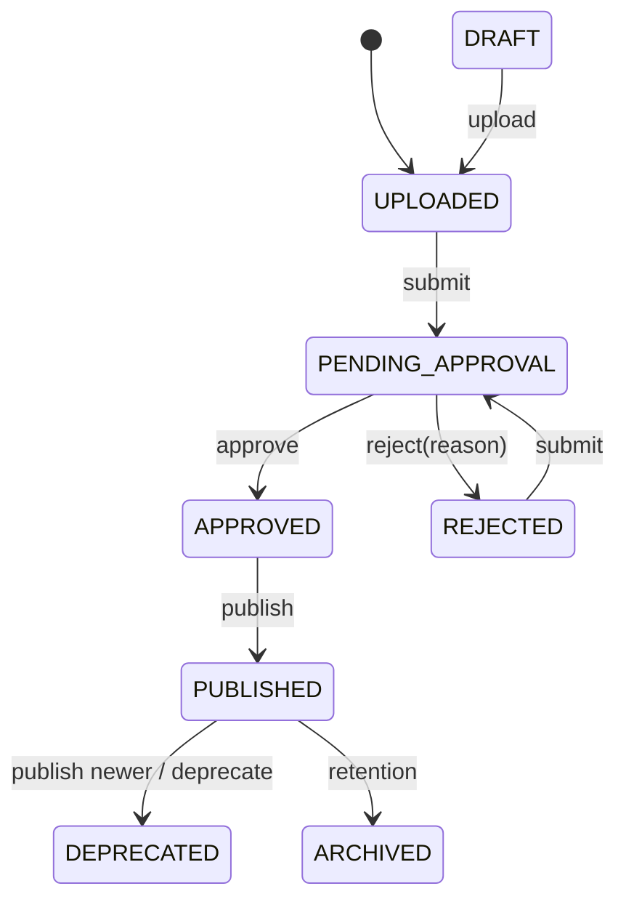
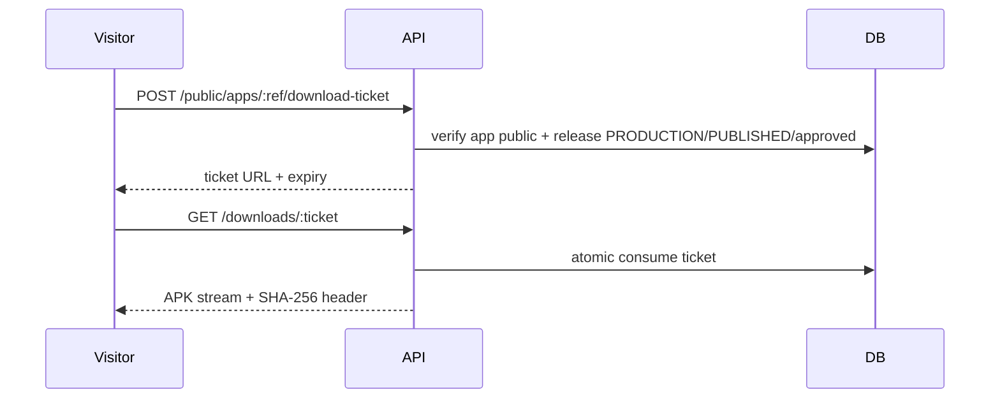

# Architecture Overview

## High-level components



- **Nginx** is the only published service. It proxies `/api/` and `/health` to the backend and everything else to the frontend container.
- **Frontend** is a static Vite build served by nginx with SPA fallback (`try_files ... /index.html`), which is why `/docs`, `/portal` and `/login` deep links work.
- **Backend** is stateless apart from the database and APK volume. It runs Prisma migrations before listening.
- **PostgreSQL** stores users, projects, apps, releases, memberships, tokens, sessions, QA records, retention state and audit rows.
- **Storage** is a local directory (`/app/storage/apks`) behind a `StorageProvider` interface.

## Repository layout

```
backend/
  prisma/schema.prisma, migrations/, seed.ts
  src/app.ts, server.ts, config/, routes/, controllers/, services/, middleware/, storage/
  tests/
frontend/
  src/App.tsx, pages/, components/, api/, docs/
nginx/default.conf
docker-compose.yml
docs/
```

## Request lifecycle

1. Client calls `/api/v1/...` via nginx.
2. Express applies Helmet, CORS, body limits and the global rate limiter.
3. Route-level middleware authenticates a Bearer JWT or `X-API-Key`.
4. API tokens additionally enforce expiry, revocation, account activity, scope and permission (`READ`/`WRITE`/`ADMIN`).
5. Resource middleware resolves project/app access (direct membership, inherited project membership, admin, or scoped token).
6. Zod validates input; controllers delegate to services.
7. Prisma reads/writes PostgreSQL; storage writes APKs atomically with temp-file + rename.
8. Audit events are recorded for security-relevant actions.
9. Errors return `{ success: false, error: { message, code } }`; internal details are hidden in production.

## Data model summary

- `User` — global role `ADMIN|DEVELOPER|VIEWER`, active flag, `tokenVersion`.
- `Project` — groups apps; unique slug.
- `App` — belongs to one project; unique package name; optional `isPublic` + `publicSlug`.
- `ProjectMembership` / `AppMembership` — role `DEVELOPER|VIEWER`.
- `Release` — version string + integer code (unique per app), channel, status, file metadata, SHA-256, approval/publication fields, CI metadata, pin flag.
- `ReleaseStatusHistory` — append-only transition trail.
- `QaVerification` — pass/fail/blocked with tester, notes, build, environment.
- `ApiToken` — SHA-256 hash, prefix, scopes, permission, expiry, revocation, last use.
- `UserSession` / `LoginEvent` / `PasswordResetToken` — session revocation, login history, hashed single-use reset tokens.
- `DownloadTicket` — hashed/JWT ticket id, release, expiry, consumption timestamp.
- `RetentionPolicy` / `CleanupRun` — per-channel days and audit of cleanup attempts.
- `AuditLog` — actor, action, entity, IP, user agent, JSON details.

## Authentication



- JWT is stored in `localStorage` (`relixor_auth_token`).
- Logout revokes the single session by `sid`.
- Password change/reset and deactivation increment `tokenVersion` and revoke sessions.
- Legacy tokens without `sid`/`tokenVersion` are still accepted for backward compatibility; new logins always include them.
- Query-string credentials are rejected.

API tokens start with `relixor_live_`, are shown once, stored as SHA-256, and carry scopes (all apps or one app) plus `READ|WRITE|ADMIN`. They are intended for CI, not browsers.

## Authorization (RBAC)

Global role sets the ceiling; project/app memberships grant resource access.

- ADMIN: full platform administration.
- DEVELOPER: create apps, upload/edit releases, view accessible apps, manage own tokens.
- VIEWER: read/download only.
- Project membership is inherited by all apps in the project.
- App membership applies to one app. Direct app membership does not grant access to sibling apps.
- API tokens cannot perform interactive-only actions (membership management, session administration, token management, account security).

Enforcement is server-side in `middleware/auth.ts`, `middleware/rbac.ts`, `middleware/resourceRbac.ts` and route-level role guards. UI hiding is convenience only.

## Upload and storage flow

1. `POST /api/v1/apps/:appId/releases` with `multipart/form-data` (`file`, metadata).
2. Multer stores to a temporary file with the configured size limit.
3. Server verifies ZIP/APK magic bytes, computes SHA-256, optionally compares a supplied checksum.
4. Storage provider moves the file atomically to its final key.
5. A `Release` row is created as `UPLOADED`; the DB write happens only after storage succeeds.
6. Audit event records upload.

Downloads stream from storage after authorization; public/QR downloads use a ticket. See [APK management](/docs/user-guide/apk-management).

## Release lifecycle



Publication requires `APPROVED`. Publishing a PRODUCTION release deprecates the previous published release. Promotion to PRODUCTION resets approval so the build must be approved again. See [Release management](/docs/user-guide/release-management).

## Public download flow



Tickets are single-use; replay returns HTTP 410. Only approved, published PRODUCTION releases of public apps are eligible.

## Audit logging

`AuditLog` captures actor, action (e.g. `AUTH_LOGIN`, `RELEASE_PUBLISHED`, `RETENTION_CLEANUP_EXECUTE`), entity type/id, IP, user agent and JSON details. Admins can filter by action/entity; exports exclude secrets. Audit rows are not deleted by retention.

## Retention

Policies are per channel. Preview computes candidates. Execution requires `RETENTION_ALLOW_DELETE=true` and archives metadata (`status=ARCHIVED`) after deleting the APK file. PRODUCTION, pinned releases and releases in active workflow states are protected.

## Migrations

Prisma migrations in `backend/prisma/migrations` are applied with `prisma migrate deploy` (automatic in the container command). Migrations are additive; destructive changes require an explicit plan and backup. See [Database](/docs/administration/database).

## Known architectural limits

- Single-node only; local disk means no horizontal scaling.
- No background job queue; the retention scheduler runs inside the API process.
- No email delivery.
- No S3 implementation.
- No WebSocket/real-time updates; the UI refreshes on navigation/actions.

## Related

- [Security](/docs/security/index)
- [API Reference](/docs/api/reference)
- [Database](/docs/administration/database)
