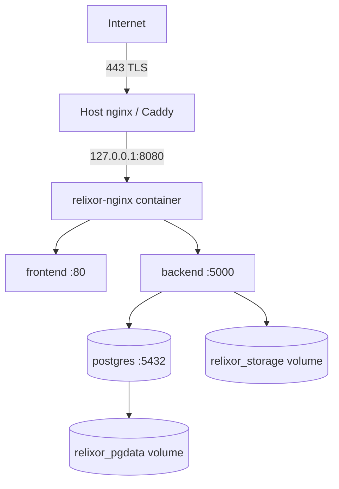

# Production Deployment

**Purpose:** deploy Relixor on a single hardened Linux VM with HTTPS.
**Verified:** Compose, nginx proxy, health checks and migrations-on-start are implemented. Host-level TLS and firewall steps are **recommended configuration**, not shipped in the repository.

## Deployment model



The repository's nginx listens on plain HTTP inside the stack. Terminate TLS on the host (recommended for a single VM) or an upstream load balancer. Do not expose the container's port directly to the internet without TLS.

## 1. Server baseline

- Ubuntu 24.04 LTS, 4 vCPU, 8 GB RAM, 100 GB SSD.
- Static private IP, DNS A/AAAA record pointing at the host.
- Non-root deploy user with Docker access.
- Time synchronised (`systemd-timesyncd`).
- Swap enabled (2–4 GB) for build spikes.

## 2. Firewall

```bash
sudo ufw default deny incoming
sudo ufw default allow outgoing
sudo ufw allow 22/tcp
sudo ufw allow 80/tcp
sudo ufw allow 443/tcp
sudo ufw enable
sudo ufw status verbose
```

Do not open `8080` or `5434` publicly. If the host proxy connects to `127.0.0.1:8080`, bind Compose to loopback:

```yaml
# docker-compose.override.yml (example)
services:
  nginx:
    ports:
      - "127.0.0.1:${HTTP_PORT:-8080}:80"
```

## 3. Environment

Copy `.env.example` to `.env`, set `chmod 600`, and configure:

- `JWT_SECRET` — 32+ random bytes, unique per environment.
- `POSTGRES_PASSWORD` — 24+ random characters; URL-safe characters avoid DSN escaping issues.
- `ADMIN_DEFAULT_PASSWORD` — 16+ characters, stored in a password manager.
- `CORS_ORIGIN=https://relixor.example.com` — exact origin, no wildcard, no trailing slash.
- `HTTP_PORT=8080` (loopback only when behind a host proxy).
- `SEED_DEMO_DATA=false`.

See [Environment Variables](/docs/configuration/environment-variables) for every variable.

## 4. Start and seed

```bash
cd /opt/relixor
docker compose up -d --build
docker compose exec backend node dist/prisma/seed.js
curl -fsS http://127.0.0.1:8080/health
```

The backend applies pending Prisma migrations on every start. Migration failure prevents the API from starting — inspect `docker compose logs backend` rather than retrying blindly.

## 5. Host TLS reverse proxy

Install nginx and certbot on the host:

```bash
sudo apt install -y nginx certbot python3-certbot-nginx
```

Create `/etc/nginx/sites-available/relixor`:

```nginx
server {
    listen 80;
    server_name relixor.example.com;
    client_max_body_size 500M;

    location / {
        proxy_pass http://127.0.0.1:8080;
        proxy_http_version 1.1;
        proxy_set_header Host $host;
        proxy_set_header X-Real-IP $remote_addr;
        proxy_set_header X-Forwarded-For $proxy_add_x_forwarded_for;
        proxy_set_header X-Forwarded-Proto $scheme;
        proxy_read_timeout 300s;
        proxy_send_timeout 300s;
    }
}
```

Enable and test:

```bash
sudo ln -s /etc/nginx/sites-available/relixor /etc/nginx/sites-enabled/relixor
sudo nginx -t
sudo systemctl reload nginx
```

Obtain a certificate:

```bash
sudo certbot --nginx -d relixor.example.com
sudo certbot renew --dry-run
```

Certbot installs a timer for renewal. Verify with `systemctl list-timers | grep certbot`. Reload nginx after renewal (`certbot` handles this by default).

> **NOT SHIPPED:** the repository Compose stack has no certbot service and no TLS listener. The above is the supported integration pattern, not a preconfigured feature.

## 6. Database and storage

- PostgreSQL data: named volume `relixor_pgdata`.
- APK storage: named volume `relixor_storage` mounted at `/app/storage/apks` in the backend.
- Backups must cover both; see [Backup & Restore](/docs/administration/backup-restore).
- Disk usage grows with every uploaded APK. Retention does not run automatically unless explicitly enabled.

## 7. Health and restart behaviour

- Container health: backend checks `wget -qO- http://localhost:5000/health` every 10s.
- Public health: `GET /health` or `/api/v1/health` through nginx.
- Restart policy: `unless-stopped` on all services.
- The health payload reports `database` and `storage`; HTTP 503 when either fails.

Monitor at least:

```bash
curl -fsS https://relixor.example.com/health
docker compose ps
docker system df
df -h /
```

## 8. Production verification checklist

- [ ] DNS resolves to the host; HTTP redirects to HTTPS.
- [ ] Certificate valid; `certbot renew --dry-run` passes.
- [ ] `/health` is 200 over HTTPS and reports database/storage ready.
- [ ] `CORS_ORIGIN` matches the HTTPS origin exactly.
- [ ] Admin password changed after first login.
- [ ] Ports 8080/5434 are not reachable from the internet.
- [ ] A test upload/download round-trip works through HTTPS.
- [ ] Backups exist and a restore has been rehearsed.
- [ ] Logs are collected and disk alerts configured.
- [ ] Retention deletion remains disabled until approved.

## 9. Upgrade and rollback

Follow [Upgrade & Rollback](/docs/administration/upgrade-rollback). Never run `prisma migrate reset` in production. Take a database and storage backup before every upgrade.

## 10. What is not supported

- Multi-node/horizontal scaling (local disk storage and single Postgres).
- S3/MinIO storage (interface exists; implementation is local only).
- Zero-downtime deploys; brief downtime occurs while the backend restarts.
- Kubernetes manifests or Helm charts.

## Related

- [Installation](/docs/installation/quick-install)
- [Environment variables](/docs/configuration/environment-variables)
- [Security guide](/docs/security/index)
- [Troubleshooting](/docs/troubleshooting/index)
