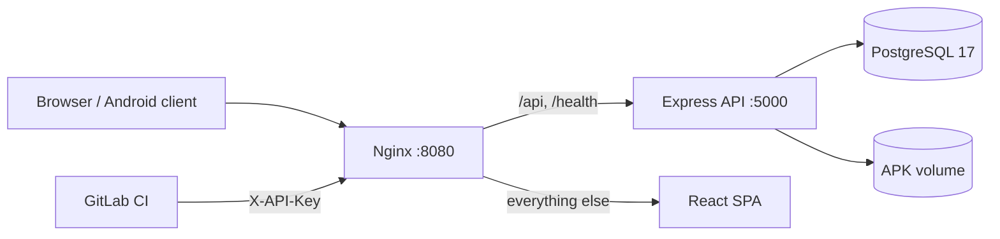

# Introduction & Quick Start

## What Relixor is

Relixor is a private APK store for Android teams. Instead of passing build files through chat or attaching them to tickets, teams upload each build once, attach version metadata, and control who can download or publish it. The platform runs entirely on your infrastructure: PostgreSQL, the Node API, the React UI and APK files on disk.

## Who it is for

- **Android teams** that need a private artifact repository with release channels.
- **QA teams** that need traceable builds and verification records.
- **DevOps teams** that want CI uploads with scoped tokens rather than shared credentials.
- **Organisations** that must keep APK binaries on their own network.

## Core capabilities

| Capability | Behaviour |
|---|---|
| Projects and apps | Apps belong to exactly one project; users can be members of projects and/or individual apps |
| Roles | `ADMIN`, `DEVELOPER`, `VIEWER`; project/app memberships are `DEVELOPER` or `VIEWER` |
| Channels | `DEV`, `QA`, `STAGING`, `BETA`, `PRODUCTION` |
| Lifecycle | `DRAFT → UPLOADED → PENDING_APPROVAL → APPROVED → PUBLISHED`, plus `REJECTED`, `DEPRECATED`, `ARCHIVED` |
| Integrity | APK/ZIP magic-byte check, SHA-256 computed server-side, optional expected checksum on CI uploads |
| Updates | Authenticated and public update-check endpoints keyed on integer `versionCode` |
| Downloads | Header-authenticated for internal users; single-use tickets for public/QR downloads |
| QA | Pass/fail/blocked verification records with notes, tester and build; JSON/CSV/PDF reports |
| Retention | Channel policies; file deletion with metadata archived; production and pinned releases protected |
| Security | JWT sessions with revocation, hashed API tokens, audit log, login history, rate limits |
| Operations | Docker Compose deployment, health endpoint, Prisma migrations on backend start |

## What Relixor is not

- It is **not** a Google Play replacement. It does not sign APKs, manage Play listings, or install apps silently.
- It is **not** a malware scanner. It validates file structure and checksums only.
- It does **not** send email. Password reset tokens are issued by an administrator and shown once.
- It does **not** provide S3 storage yet, despite the provider interface; only local disk is active.
- It is **not** a general-purpose file store. Only APK artifacts are accepted.

## Architecture at a glance



All containers share the private `relixor_net` bridge. Only nginx publishes a host port (`HTTP_PORT`, default `8080`). PostgreSQL is exposed on the host only for operator convenience (`POSTGRES_PORT`, default `5434`) and should be firewalled.

## Technology stack

- Frontend: React 18, TypeScript, Vite 5, Tailwind CSS, lucide-react, qrcode.react.
- Backend: Node.js 20, Express 4, TypeScript, Zod, Multer, Helmet, express-rate-limit.
- Data: PostgreSQL 17 with Prisma 5 (7 migrations at v1.0).
- Runtime: Docker multi-stage images; nginx serves the SPA and proxies the API.
- Tests: Jest + Supertest against a disposable PostgreSQL database.

## Requirements

### Minimum (evaluation only)

- 2 vCPU, 2 GB RAM, 10 GB disk.
- Ubuntu 22.04/24.04 (other Linux distributions work if Docker runs).
- Docker Engine 24+ with Compose v2, Git, curl.
- Outbound access to pull `node:20-alpine`, `postgres:17-alpine`, `nginx:alpine`.

### Recommended production

- 4 vCPU, 8 GB RAM, 100 GB SSD (APK storage dominates).
- Separate backup target with at least 2× the APK volume size.
- A DNS name and TLS termination at the host or an upstream load balancer.
- Monitoring of `/health`, disk usage and container restarts.

## First-time installation (short version)

```bash
git clone <your-repository-url> relixor
cd relixor
cp .env.example .env
# edit .env: strong POSTGRES_PASSWORD, JWT_SECRET, ADMIN_DEFAULT_PASSWORD, CORS_ORIGIN
docker compose up -d --build
docker compose exec backend node dist/prisma/seed.js
curl -fsS http://localhost:8080/health
```

Open `http://<server>:8080`, sign in with `ADMIN_DEFAULT_EMAIL` and the password you set. The detailed, failure-aware version is [Installation on Ubuntu](/docs/installation/quick-install).

## First login checklist

1. Change the administrator password under **Profile** (this revokes other sessions).
2. Create a project (**Projects → New Project**).
3. Register an application and note its UUID.
4. Create a user and grant project or app membership.
5. Upload a DEV build and walk it through submit → approve → publish.
6. Mark an app public only when you intend external distribution.
7. Create a scoped API token for CI; copy it once and store it in the CI secret store.
8. Schedule backups before enabling retention deletion.

## Key terminology

See the [Glossary](/docs/GLOSSARY). The two terms that cause the most confusion:

- **versionCode** — the monotonic integer Android uses for upgrades. It is **not** the display version string.
- **publication** — an ADMIN setting on an app (`isPublic` + `publicSlug`). A public app still exposes only PRODUCTION, `PUBLISHED`, approved releases.

## Related guides

- [Installation](/docs/installation/quick-install)
- [Environment variables](/docs/configuration/environment-variables)
- [Architecture](/docs/architecture/overview)
- [Release management](/docs/user-guide/release-management)
