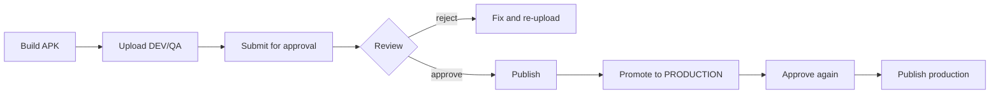

# Developer Manual

You are a `DEVELOPER`: you can create apps, upload builds, iterate, and move releases through the workflow for the projects/apps you can access.

## Daily workflow



1. Increase `versionCode` for every upload.
2. Upload to DEV for iteration or QA for testing.
3. Attach commit SHA, branch, pipeline ID and build timestamp.
4. Submit for approval when the build is a candidate.
5. Fix rejections by uploading a **new** build (do not reuse versionCode).
6. Publish approved builds; promote to PRODUCTION only after QA evidence.
7. Production promotion resets approval — get a second review.

## Upload via UI

Open the app → **Upload APK**. Fields: file, version, versionCode, channel, notes, mandatory, min supported version. The server computes SHA-256; compare it with your artifact.

## Upload via CI

Use a scoped WRITE token in `X-API-Key`. Full pipeline: [GitLab CI](/docs/integrations/gitlab-ci). Minimal curl:

```bash
curl --fail-with-body -H "X-API-Key: $RELIXOR_API_TOKEN" \
  -F "file=@app-release.apk" -F "version=1.4.0" -F "versionCode=140" \
  -F "channel=QA" -F "sha256=$(sha256sum app-release.apk | cut -d' ' -f1)" \
  "$RELIXOR_URL/api/v1/apps/$RELIXOR_APP_ID/releases"
```

## What you cannot do

- Create projects (ADMIN only).
- Delete apps (ADMIN only).
- Manage memberships, users, sessions or retention (ADMIN only).
- Set public visibility (`PUBLICATION_ADMIN_ONLY`).
- Approve your own upload by default (`SELF_APPROVAL_FORBIDDEN`).
- See apps you have no membership for.
- Use an API token to administer the platform.

## Tokens

Create your own scoped token under **Tokens**. Prefer app-scoped WRITE with an expiry. The plaintext appears once. Never commit it, put it in a URL, or paste it into build logs. Revoke immediately if exposed.

## Testing a build

- Use the authenticated download or QR ticket (QR requires a publicly downloadable production release; internal releases cannot issue QR downloads).
- Compare SHA-256 after download.
- Ask QA to record a verification against the exact release; approval should reference that evidence.

## Common errors

| Error | Meaning | Action |
|---|---|---|
| `FORBIDDEN_RESOURCE_ACCESS` | No app membership | Ask admin |
| `SELF_APPROVAL_FORBIDDEN` | You uploaded and tried to approve | Ask another reviewer |
| `RELEASE_NOT_APPROVED` | Publish before approval | Submit + approve first |
| `DUPLICATE_RELEASE` | version+versionCode reused | Bump versionCode |
| `CHECKSUM_MISMATCH` | Hash mismatch | Recompute/re-upload |
| `FORBIDDEN_TOKEN_PERMISSION` | READ token used to write | Use WRITE |
| `FORBIDDEN_APP_SCOPE` | Token for another app | Use correct token |

## Related

- [Release management](/docs/user-guide/release-management)
- [APK management](/docs/user-guide/apk-management)
- [GitLab CI](/docs/integrations/gitlab-ci)
