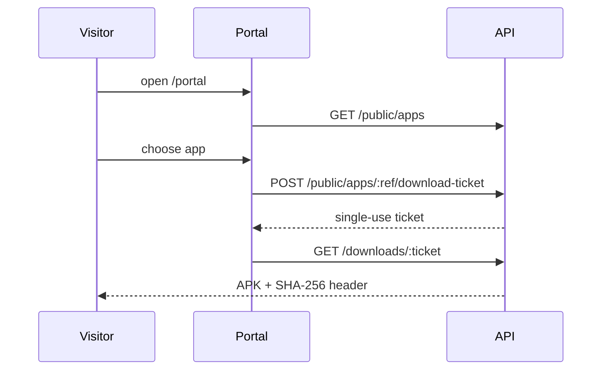

# Public Download Portal

## Purpose

The portal at `/portal` lets people without a Relixor account browse published apps and download their current production APK. It is designed for customers, field staff and testers who should not receive platform credentials.

## What is visible

An app appears only when **all** are true:

1. `isPublic = true` and a `publicSlug` is set (ADMIN-only).
2. It has at least one release that is `channel=PRODUCTION`, `status=PUBLISHED`, `publishedAt` set (and therefore approved).

Within a public app, only that current production release is exposed. DEV, QA, STAGING and BETA releases, drafts, pending approvals, rejected builds and deprecated history remain private. Release notes, version, versionCode, size and SHA-256 are shown; uploader identity and internal metadata are not.

## Publish an app publicly (ADMIN)

1. Open the app → **Publication settings**.
2. Enable public listing and set a unique, URL-safe slug.
3. Ensure a production release is approved and published.
4. Open `/portal` and verify the app appears; open `/portal/<slug>`.
5. Download the APK and compare its SHA-256 with the release page.

Disabling publication immediately removes the app and its downloads from public endpoints. Existing issued tickets expire and cannot be redeemed after the release stops qualifying.

## Download flow

Tickets are single-use and short-lived. Replaying a ticket returns HTTP 410. Downloads are rate-limited (120 requests / 15 minutes per IP for the downloads route).

## QR codes

Public QR codes encode a ticket URL generated for the current release. They are convenient for test devices but are not permanent links; regenerate after expiry. Never encode API tokens or user JWTs.

## Security properties

- No authentication bypass: public routes query only qualifying releases.
- No directory listing: storage keys are never exposed; downloads are streamed by the API.
- No credential in URL: only opaque tickets.
- Public metadata is limited; internal fields are excluded by the public serializer.
- Publication is admin-only; developers cannot widen exposure.

## Troubleshooting

| Symptom | Check |
|---|---|
| App missing from `/portal` | `isPublic`, `publicSlug`, production release published and approved |
| 404 on `/portal/<slug>` | Slug typo or publication disabled |
| 409 on ticket | Release is not PRODUCTION/PUBLISHED or app not public |
| 410 on download | Ticket expired/used; request another |
| Portal blank | SPA deep-link fallback; check nginx `/` routing |
| Download stalls | nginx proxy timeouts and file size; check backend logs |

## Related

- [APK management](/docs/user-guide/apk-management)
- [Android update API](/docs/integrations/android-update-api)
- [Security](/docs/security/index)
