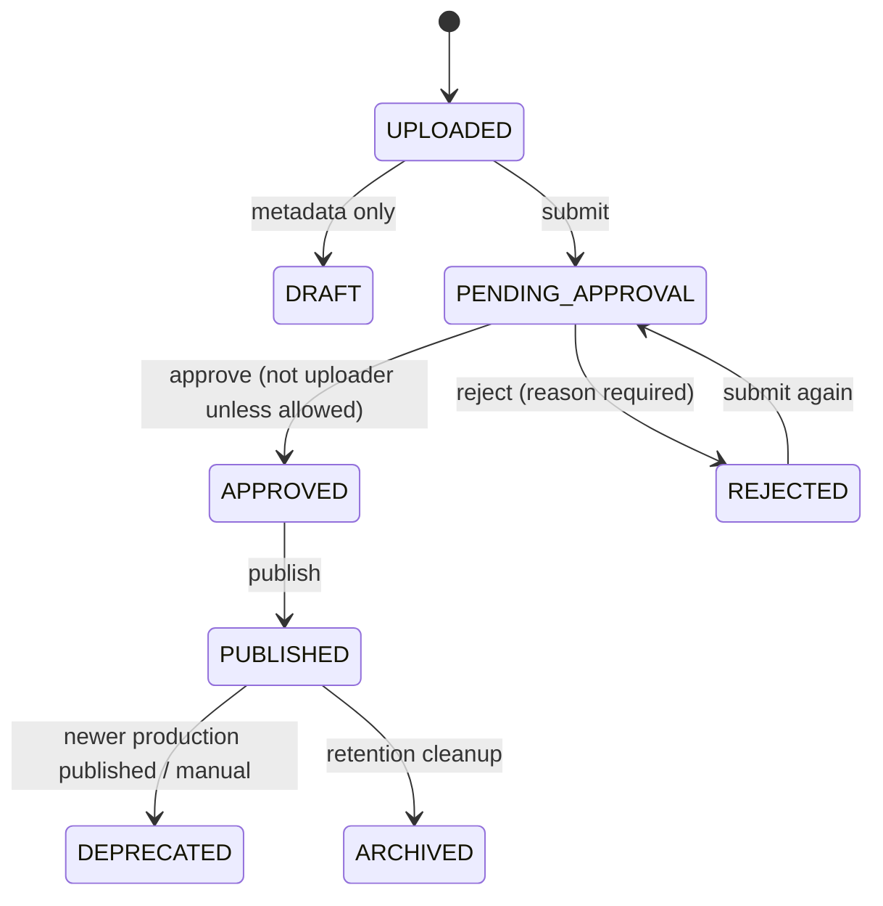

# Release Management

## Versioning rules

- **version** — display string, allowed characters `A–Z a–z 0–9 _ - + .` (for example `1.4.2`, `2026.11.12-beta`). Not parsed for ordering.
- **versionCode** — positive integer; Android's upgrade comparator. Must increase for real upgrades. Unique together with `version` per app; re-uploading the same pair returns a conflict.
- **minSupportedVersionCode** — optional floor used by the update API to force upgrades.

Use semantic versioning for humans and a monotonically increasing integer for devices. Never reuse a released versionCode.

## Channels

`DEV → QA → STAGING → BETA → PRODUCTION`. Channels are labels and policy boundaries, not automatic promotion. A build uploaded to DEV can be promoted, which creates/updates the release channel while resetting approval when moving to PRODUCTION.

## Statuses and transitions

| Transition | Who | Rules |
|---|---|---|
| Submit | ADMIN, DEVELOPER with access, WRITE token | `UPLOADED` or `REJECTED` only |
| Approve | ADMIN; DEVELOPER if not uploader or `ALLOW_SELF_APPROVAL=true` | `PENDING_APPROVAL` only |
| Reject | same as approve | Requires non-empty reason |
| Publish | ADMIN, DEVELOPER with access | Requires `APPROVED`; sets `publishedAt`; PRODUCTION publication deprecates the previous published release |
| Deprecate | ADMIN, DEVELOPER | Published releases |
| Promote | ADMIN, DEVELOPER | Target channel; moving to PRODUCTION resets approval |
| Rollback | ADMIN, DEVELOPER | Restores a prior PRODUCTION release as current; audit recorded |
| Delete | ADMIN, DEVELOPER | Protected when PRODUCTION, pinned, or in active workflow; files removed |

Approval is a **separation-of-duties** control. An admin can always approve; a developer cannot approve their own upload by default.

## Upload and metadata

1. Open an app → **Upload release**.
2. Choose the APK, version, versionCode, channel, release notes.
3. Optionally set title/description, mandatory, min supported version, pin, CI metadata.
4. Upload. Status starts `UPLOADED`.

The server:
- accepts only `.apk` and checks ZIP magic bytes (`PK\x03\x04`);
- enforces `MAX_FILE_SIZE_MB` (default 500);
- computes SHA-256;
- if a `sha256` field is supplied (CI), rejects mismatch with `CHECKSUM_MISMATCH`;
- stores the file before writing the DB row.

## Review and publication

1. Developer submits: status `PENDING_APPROVAL`.
2. Reviewer inspects version, channel, checksum, commit/pipeline metadata and QA results.
3. Reviewer approves or rejects with a reason.
4. Publisher publishes. Only now can the release be downloaded publicly (if the app is public) and appear as current production.

Publication does **not** make a DEV/QA/STAGING release public.

## Promotion

Promotion moves a release to a new channel. Promoting to PRODUCTION clears approval and publication, so the build must be approved and published again. This prevents an unreviewed QA artifact from becoming production.

## Rollback

Rollback selects an earlier PRODUCTION release and makes it current, recording an audit event. It does not rebuild or re-sign anything. If the previous APK was deleted by retention, rollback is not possible — another reason to pin releases you may need.

## Deprecation and archiving

- **DEPRECATED** — no longer current but retained and downloadable internally.
- **ARCHIVED** — APK bytes deleted by retention; metadata remains for audit/history. Cannot be downloaded.

## Mandatory updates and minimum version

- `isMandatory` marks a release as required.
- `minSupportedVersionCode` forces clients below the floor to update.
- The update API returns `updateAvailable` and `mandatoryUpdate`; devices must implement the UI and installation flow.

## CI metadata

Uploads may include `gitCommitSha`, `gitBranch`, `gitlabPipelineId`, `gitlabPipelineUrl` and `buildTimestamp`. These are displayed with the release and included in reports, giving traceability from artifact to pipeline.

## History and audit

- **Status history** records every transition with actor and timestamp.
- **Audit log** records upload, submit, approve, reject, publish, promote, rollback, delete and download actions.
- QA verifications attach to the release and appear in reports.

## Release checklist

- [ ] versionCode increased and unique
- [ ] correct channel
- [ ] SHA-256 matches CI artifact
- [ ] commit and pipeline metadata present
- [ ] QA result recorded (for QA/STAGING/PRODUCTION)
- [ ] approval by someone other than uploader
- [ ] release notes readable by end users
- [ ] min supported version set if older clients must upgrade
- [ ] pin the release if it must survive retention

## Common errors

| Error | Fix |
|---|---|
| `DUPLICATE_RELEASE` / unique constraint | Bump versionCode |
| `INVALID_APK_FILE` | Upload a real APK/ZIP |
| `CHECKSUM_MISMATCH` | Recompute checksum; do not bypass |
| `RELEASE_NOT_APPROVED` | Approve before publishing |
| `SELF_APPROVAL_FORBIDDEN` | Ask another reviewer/admin |
| `RELEASE_PROTECTED` | Production/pinned/active release cannot be deleted |
| `INVALID_CHANNEL` | Use DEV, QA, STAGING, BETA, PRODUCTION |

## Related

- [APK upload/download](/docs/user-guide/apk-management)
- [QA reports](/docs/user-guide/qa-reports)
- [GitLab CI](/docs/integrations/gitlab-ci)
- [Android update API](/docs/integrations/android-update-api)
